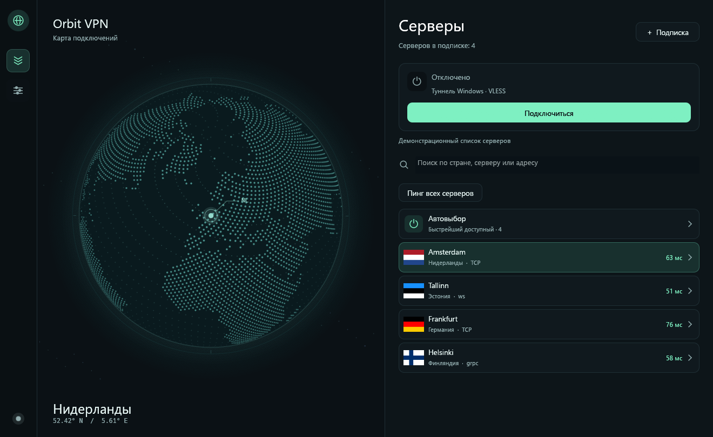

# Orbit VPN

Клиент VLESS для Windows на Rust с глобусом, который поворачивается к стране выбранного сервера. Поддерживает системный туннель Xray TUN и локальный HTTP-прокси.



## Скачать и запустить

На [странице релизов](https://github.com/sava71601-lgtm/OrbitVPN/releases) доступны два файла. Для установки достаточно **Orbit-VPN-Setup.exe**. Архив **Orbit-VPN-Source-v0.3.6.zip** нужен для просмотра или сборки исходников.

1. Откройте установщик и нажмите **Установить**. Xray и Wintun уже внутри. По умолчанию установщик создаёт ярлык на рабочем столе.
2. Запустите Orbit VPN и подтвердите системный запрос UAC. Режим **VPN для Windows (TUN)** выбран по умолчанию.
3. В разделе **Серверы** нажмите **+ Подписка**, вставьте HTTPS-адрес, ссылку `vless://` или список ссылок, выберите сервер и нажмите **Подключиться**. Если Windows уже использует туннель другого VPN как основной маршрут, отключите его перед подключением Orbit.

Поддерживаются подписки со списками ссылок в обычном тексте или Base64, встроенные VLESS-узлы из Mihomo YAML и их группы `url-test`. Поддерживаемые транспорты включают TCP, WebSocket, gRPC, HTTPUpgrade и XHTTP. Для защиты соединения доступны TLS и REALITY.

## Как это работает

### Трафик и DNS

Orbit проверяет HTTPS через выбранный VLESS-узел до включения туннеля. Затем приложение запускает Xray с TUN-входом и драйвером Wintun. Xray настраивает маршруты Windows, а исходящее соединение Xray с VLESS-сервером остаётся на физическом интерфейсе.

Запросы DNS с TUN направляются на локальный резолвер Orbit по UDP или TCP. Резолвер отправляет DNS-over-HTTPS через тот же Xray и выбранный узел. В качестве резервного DoH-сервера используется второй адрес. Перед показом статуса «Подключено» Orbit проверяет маршруты Windows, DNS и HTTPS. При неудачной проверке туннель закрывается.

В режиме локального HTTP-прокси Orbit выводит адрес `127.0.0.1:порт` для ручной настройки нужного приложения. Системные маршруты в этом режиме не меняются.

### Подписки и задержка

- **Обновить** загружает список заново по сохранённому HTTPS-адресу. Автообновление работает, пока приложение открыто. Период по умолчанию — 6 часов. Доступны час, сутки и отключение. Если загрузка или разбор ответа не удались, предыдущий список остаётся доступен, а текущее подключение сохраняется.
- **Пинг всех серверов** показывает время ответа. В настройках доступны HTTPS Keep-Alive, TCP и ICMP. HTTPS Keep-Alive измеряет повторный запрос через открытое соединение. Для измерения задержки всех узлов вручную сначала отключите активный TUN.
- **Автовыбор** проверяет узлы выбранной группы и подключается к самому быстрому из ответивших. Orbit сохраняет отдельный VLESS-узел провайдера с названием `Auto`.
- **Переподключение** срабатывает при остановке Xray или двух подряд неудачных проверках активного узла. Orbit измеряет задержку запасных узлов по HTTPS и пробует их от меньшей к большей до успешного подключения. Во время переключения TUN временно закрывается.

### Глобус и локальные данные

Глобус отображает страну активного узла. При необходимости страну выбранного сервера можно исправить в **Настройки → Глобус**.

Orbit сохраняет подписку, список серверов, способ замера и частоту обновления в локальном профиле Windows. Файл `preferences.dat` шифруется средствами Windows DPAPI. В `%LOCALAPPDATA%\Orbit VPN\last-connection.txt` сохраняется итог последней попытки подключения без ключа подписки. Для проверок доступности используются Google Connectivity Check и Cloudflare, для DNS-over-HTTPS — Cloudflare и Google DNS.

## Сборка из исходников

Понадобятся Windows x64, PowerShell 7 и Rust с инструментами сборки для Windows. Для MSVC откройте консоль Visual Studio, где доступен `rc.exe`. Для GNU укажите компоновщик в `CARGO_TARGET_X86_64_PC_WINDOWS_GNU_LINKER` и добавьте в `PATH` соответствующий `windres.exe`.

```powershell
pwsh -File ./scripts/prepare-xray.ps1
cargo test --locked
cargo build --release --locked
```

Скрипт скачивает Windows x64-архив Xray-core v26.11.9, сверяет SHA-256 и создаёт `assets/runtime.pack` для встраивания в установщик. Можно передать проверенную локальную копию этого архива через `-Archive`. Готовый установщик после сборки находится в `target/release/orbit-vpn.exe`. Для тестов с реальным Xray можно задать переменную `ORBIT_TEST_XRAY` с путём к `xray.exe`.

| Файл | Назначение |
| --- | --- |
| `src/main.rs`, `src/globe.rs` | Интерфейс, настройки и трёхмерная проекция точечного глобуса |
| `src/subscription.rs`, `src/preferences.rs` | Импорт и локальное хранение подписки |
| `src/runtime.rs`, `src/tunnel.rs` | Xray, маршруты Windows, диагностика и переподключение |
| `src/dns.rs`, `src/probe.rs` | Локальный DNS-резолвер и методы измерения задержки |
| `src/setup.rs`, `build.rs` | Установщик и ресурсы Windows |

## Лицензии и данные

Код Orbit VPN распространяется по [MIT](LICENSE). Встроенные компоненты сохраняют лицензии своих проектов. Лицензии Xray и Wintun распаковываются вместе с ними в локальный каталог приложения.

- [Xray-core v26.11.9, исходники и релиз](https://github.com/XTLS/Xray-core/tree/v26.11.9)
- [Wintun, исходники и условия для готовых двоичных файлов](https://www.wintun.net/)
- [Natural Earth, границы стран 1:110m](https://github.com/nvkelso/natural-earth-vector/blob/v5.1.2/geojson/ne_110m_admin_0_countries.geojson)
- [Flag Icons](https://github.com/lipis/flag-icons/tree/v7.6.0) и [лицензия на флаги](assets/FLAG-ICONS-LICENSE.txt)
